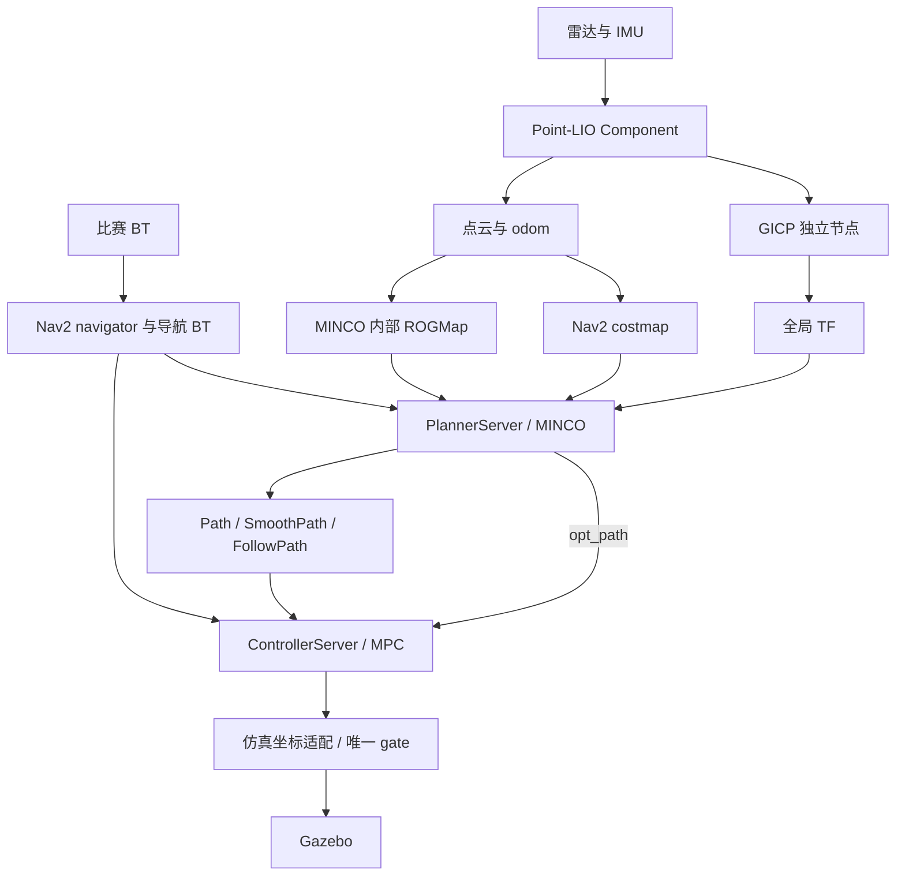
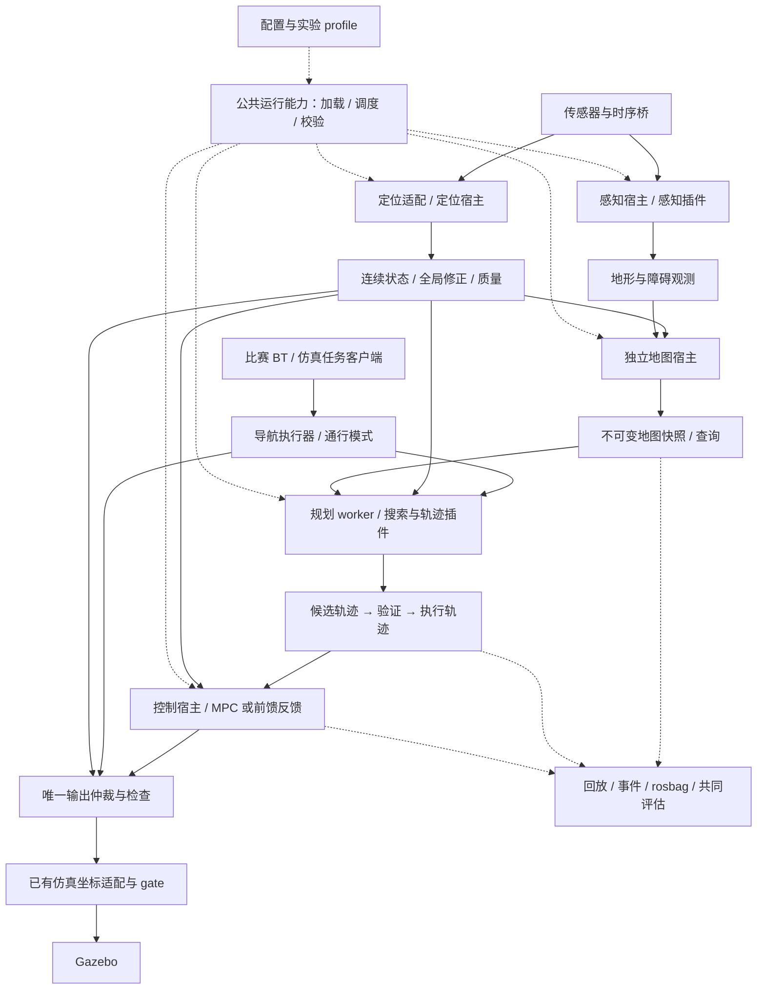

# 本地算法插件框架：架构规格

版本：v1，2026-11-12。工作空间：`/home/liu/ds_nav`。

**状态：用户已确认设计决策 Q1–Q34；本文是实现输入，不是实现或验收完成证明。** 本次仅交付文档。配套：[AI 执行说明](02_AGENT_EXECUTION.md)、[人工验收说明](03_HUMAN_ACCEPTANCE.md)。

## 1. 目标、交付边界与两条工作线

建立“稳定运行宿主＋类型化本地算法插件＋配置组合＋公共评估工具”。已适配且安装的算法只改配置并重启即可替换；新增 C++ 算法仍须编写适配、注册、编译安装。第一版不支持车辆运动中热切换。

| 工作线 | 执行边界 | 本项目关系 |
|---|---|---|
| 实车保底线 | 当前实车架构先跑通并持续维护 | 原入口、参数、比赛 BT、协议不被新框架覆盖；本交付不启动实车调试 |
| 新框架仿真线 | 当前仿真环境上实现、回放、对比、闭环验收 | 本规格第一版范围 |
| 后续实车迁移 | 仿真通过的指定组合，单独制定实车阈值并授权 | 不由仿真成功自动触发，不照搬仿真阈值 |

第一版必须完成：独立地图宿主、搜索/轨迹接口、四种规划组合、两种控制器、导航执行器、配置能力校验、日志/录包/回放、场景与故障验收。感知、Point-LIO 与 GICP 先保留现有实现，通过适配提供稳定数据契约；第一版不声称已证明所有定位/感知算法可互换。

最终目标：不启动 Nav2 导航服务，公共接口及核心算法不依附 `nav2_core` / `nav2_behavior_tree`。允许过渡适配器复用现有库，但必须标注依赖；过渡通过不等于最终去依赖通过。不自行重写 ROS 2、pluginlib 或已有可靠算法。

## 2. 当前源码事实与风险

以实际源码为准，不以文件名或旧归档推断活动链：

| 当前职责 | 权威入口/源码 | 迁移风险 |
|---|---|---|
| 实车启动 | `start.bash`；`src/navigation/navi2_bringup/launch/navigation2.launch.py` | 默认实车参数为 sentry1.yaml，不能与仿真混用 |
| 仿真启动 | `scripts/huananhu_sim.bash`；`src/simulation_integration/huananhu_sim_bringup/launch/simulation.launch.py` | 使用独立进程、控制适配与门控 |
| 仿真导航 | 同包 `launch/navigation.launch.py`、`config/navigation_sim.yaml` | simulation_planner_server 仍承载 Nav2 PlannerServer |
| 比赛导航任务 | `src/decision/bt_manager/include/bt_manager/action/nav_action.hpp` | 继承 Nav2 BT Action 包装；新执行器需适配，不改比赛优先级 |
| 搜索与优化 | `minco_planner/.../components/global_path_searcher.*`、`minco_planner.cpp` | 内部选择 SMAC/A*，不是独立可选插件 |
| 地图 | `minco_planner.cpp::configureRogMap`、`components/planner_mode_context.cpp` | ROGMap 由 MINCO 创建；PRIORMAP 强制使用 Nav2 全局地图查询 |
| 控制 | `minco_controller/src/minco_mpc_controller.cpp` | 直接 /cmd_vel_mpc 与返回 Nav2 的速度存在不同分支，迁移须查清实际输出 |
| 轨迹协议 | `src/ros_interfaces/msg/minco_traj/*.msg` | 有 trajectory_id，无每点显式相对时间或任务世代 |



MPC 当前以最近空间点投影和 `1/planner_freq` 解释参考；时间推进与 age>0.5 拒绝代码存在注释，不能当作现成过期保护。取消进入 WAIT_GOAL 不等于已证明整条链停车。

`docs/simulation_integration/README.md` 报告归档主9项、冷启动2项通过；本规格不把该文档报告作为本轮重跑证据。README 明确动态障碍专项、台阶、多算法和实车尚非其覆盖范围。归档和当前哈希必须执行时重新核对。

## 3. 目标逻辑与进程架构



框是职责，不规定一框一进程。部署必须满足：

- 控制与最终输出不与实验规划 worker 共进程。地图是否与规划同进程由带宽/锁竞争测量决定。
- Point-LIO/驱动组合先保留现有边界，不擅自改变 QoS、频率或 TF 发布者。
- 控制宿主20 Hz，不等待规划或地图服务阻塞。插件不自行创建第二控制 timer。
- 纯 C++ 算法可用 pluginlib；现有复杂 ROS/Python/GPU 实现可用独立进程适配，统一 profile 和契约，不强制重写。
- 取消和 deadline 需要合作检查；非合作算法由 worker 隔离。超时后丢弃结果，不允许后台任务无界积压或逐请求泄漏进程。
- 启动、重启、停用均需明确状态，进程退出后旧输出不能保持有效。

## 4. 建议代码组织与依赖方向

```text
src/algorithm_framework/
  ds_algorithm_interfaces/     # ROS消息/Action与C++契约；不依赖Nav2
  ds_algorithm_runtime/        # loader、能力校验、宿主与worker管理
  ds_navigation_executor/     # 任务、抢占、取消、到达、通行模式
  ds_algorithm_benchmark/      # 固定输入、回放、案例、评分
src/algorithms/
  perception/                 # 按点云/地形/检测/跟踪细分插件
  localization/               # 现有里程计与全局定位适配
  mapping/                    # 先验+实时地图适配与实现
  planning/                   # search与trajectory插件包
  control/                    # MPC与全向前馈反馈
config/algorithm_framework/
  robot.yaml                  # 尺寸、运动约束
  competition/<season>/       # 地图、区域、通行要求
  algorithms/                 # 插件参数和私人IO声明
  profiles/                   # baseline与A-E冻结组合
```

算法包包含 `vendor/`、`adapter/`、`plugins.xml`、构建注册、参数示例、最小用例与来源/许可证说明；vendor 仅放确实需要的代码，不复制整个第三方工作空间。新源码测试放包内 `test/`，注意根 `.gitignore` 有 `test/` 等规则，交付须检查忽略状态；不得通过 Git 写操作解决。

依赖方向：接口→宿主/插件；插件不得反向依赖比赛 BT。比赛层只调用任务接口。未来定位与感知算法替换在各自类别接口完成，不建立万能 `Algorithm::run(void*)`。

## 5. 公共契约与私人扩展

| 类别 | 输入 | 输出与必备约束 |
|---|---|---|
| 点云处理 | 带时间、frame、必要点属性的观测 | 明确原始/去畸变/降采样/世界系，不能互相冒充 |
| 地形/检测/跟踪 | 对应观测与状态 | 类别/位置/可选速度/质量；未知速度不能填零冒充静止 |
| 局部里程计 | 声明所需传感器 | 连续状态、质量、可选去畸变点云；全局跳变单独表达 |
| 全局定位 | 地图、局部状态、观测 | 全局修正与质量；TF 每条边单一发布者 |
| 地图 | 先验、观测、连续状态 | 占据/未知/距离/地形查询；版本、frame、时间与并发规则 |
| 搜索 | 地图、起终状态、约束、context | 几何路径、状态、诊断；可选原生时间轨迹能力 |
| 轨迹生成 | 路径或地图、边界状态、约束 | 显式时间p/v/a/yaw；能力不足拒绝激活 |
| 控制 | 时间轨迹、当前状态、约束 | 候选速度与状态；frame/单位明确，不直发底盘 |

公共 envelope：schema_version、run_id、task_id/task_epoch、request_id、生成与测量时间、frame、validity、状态/原因。状态至少区分 SUCCESS、NO_PATH、TIMEOUT、CANCELED、INVALID_INPUT、UNSUPPORTED、INTERNAL_ERROR。缺失/未知/失败不能用零值替代。

轨迹至少包含：trajectory_id、task_epoch、map_version、生成时间、执行起始时间、有效截止时间、严格递增的 time_from_start、位置/速度/加速度、yaw/yaw_rate及各字段有效标志。重复发布不得刷新真实有效期；任务切换、仿真回退/重置时旧世代永不恢复。

时间与采样：轨迹语义使用仿真 ROS clock；计算预算使用 steady clock；log 同时记录两者。规定插值、yaw unwrap、边界采样、frame变换时刻、时延补偿与重采样误差。缺 jerk/角速度等字段按能力显式标记，不强行补零。暂停时不推进轨迹；健康检查按现有gate的墙钟行为进入停用，恢复前重验状态；不能在暂停中伪造更新。

私人接口：插件在自身目录定义额外消息/话题/服务，声明名称、类型、方向、必需性、frame、时间、QoS、录制和回放依赖。profile 校验缺失必需输入；额外输出不得隐式改变其他插件。公共接口不用因单个算法偏好频繁修改。使用额外信息的比较标注“增强输入组”，与公共输入组分开排名。真值仅评估，不得进入算法或控制输入。

接口草图（不是可直接编译代码）：

```cpp
class SearchAlgorithm {
public:
  virtual Capabilities capabilities() const = 0;
  virtual SearchResult plan(const SearchRequest&, const MapSnapshot&,
                            const ExecutionContext&) = 0;
  virtual ~SearchAlgorithm() = default;
};
// ExecutionContext: steady deadline + cooperative cancellation。
// ControllerAlgorithm::compute(StateSnapshot, TimedTrajectory, Limits, Context)
// 返回 CandidateCommand，不自行发布执行速度。
```

## 6. 五组主矩阵与配置

| ID | 搜索 | 时间轨迹生成 | 控制 | 意义 |
|---|---|---|---|---|
| A | SMAC | MINCO | MPC时间模式 | 主参照 |
| B | A* | MINCO | MPC时间模式 | 搜索替换 |
| C | Kastar位置路径 | MINCO | MPC时间模式 | 搜索前端对比，不能代表原生Kastar轨迹 |
| D | Kastar直接规划 | 保留原生时间的适配 | MPC时间模式 | 完整轨迹生成对比 |
| E | SMAC | MINCO | 全向前馈＋反馈 | 同参考下控制器替换 |

MPC 最近点投影兼容模式另作新旧回归，不与主矩阵混算。MPPI/DWB 本地虽有安装，当前 Path/costmap 接口不等价于时间轨迹跟踪，第一版不接入。

配置文件是规格示例，尚无对应可执行 launch。ROS2参数封装、include解析由实现统一完成，最终必须有完整解析后profile供审计。

```yaml
schema_version: 1
profile_id: A_smac_minco_mpc
runtime:
  mode: execute
  use_sim_time: true
  control_hz: 20.0
  max_plan_hz: 10.0
  planning_budget_ms: 80.0
  old_trajectory_grace_s: 0.2
localization:
  odometry_plugin: ds_localization/PointLioAdapter
  global_plugin: ds_localization/GicpAdapter
mapping:
  plugin: ds_mapping/PriorAndLiveMap
planning:
  pipeline: search_then_optimize
  search_plugin: ds_search/Smac
  trajectory_plugin: ds_trajectory/Minco
  yaw_policy: keep_initial
control:
  plugin: ds_control/MincoMpc
  reference_mode: explicit_time
```

C只替换search_plugin；D显式改为direct_trajectory和TdtKastarTimed适配，不暗中再跑MINCO；E只替换control插件。机器人约束、地图、评估条件、yaw策略和公共输入固定。未知插件、未知/冲突参数、能力缺失都拒绝激活，不能静默回退。

Kastar专项：`/home/liu/tdt-nav-kit`为当前源。图像0是障碍，OccupancyGrid重载非零即障碍，必须统一转换而非原样塞Nav2 costmap；核对Y翻转/原点；每轴速度/加速度不同于模长上限；缺yaw；终速固定零；无原生取消/deadline。局部滚动目标停车倾向应记录。2D结果不能作为3D通行证明。

## 7. 任务、轨迹切换与唯一执行出口

任务状态至少覆盖 READY、PLANNING、EXECUTING、DEGRADED_OLD_TRAJECTORY、STOPPING、SUCCEEDED、CANCELED、FAILED、DISABLED。只允许执行器接受候选为执行轨迹，原子更新ID与有效期；晚到/旧世代/超时结果拒绝，保留拒绝证据。

| 事件 | 必须执行的行为 |
|---|---|
| 新有效轨迹 | 新轨迹可覆盖旧轨迹；检查任务/状态连续与约束，记录切换 |
| 规划失败/超时 | 从首次未获有效替代轨迹时刻计时，旧轨迹最多续行0.2s；连续失败不得重置宽限 |
| 宽限内不健康/新障碍/轨迹无效 | 立即撤销续行并停车，不等待0.2s |
| 取消、定位失效、时间回退 | 增加世代、使旧轨迹失效、停止运动输出；不能宽限续行 |
| 人工接管 | 自动来源失效，明确仲裁；回自动需重新确认状态/任务 |
| 插件崩溃/失联 | 控制保持独立，候选撤销；记录退出与停车；不得自动重放旧任务 |

延续检查使用已有接受时全段校验加必要的局部/变化区域检查，避免重复全段高频拒绝。新障碍不能因“旧轨迹”而跳过检查。算法不直接发实际速度、不写比赛blackboard；私人输出同样遵守。

仿真仍经 `global command -> body-frame adapter -> /sim/auto_cmd_vel -> sim_command_gate -> /sim/actuator_cmd_vel`，不得增加绕过gate的出口。实车 `/cmd_vel_mpc` 世界系语义暂不变；新框架不在实车域创建它。

暂停/时间回退、map切换、生命周期停用、异常退出都要覆盖。最终依赖清理需替代SmoothPath/GoalChecker/progress/lifecycle/LoadMap等必要职责，不允许仅删launch。

## 8. 仿真数值、证据与准入

用户确认：20Hz控制、最高10Hz规划、80ms单次规划预算、0.2s失败续行、普通终点≤0.15m、yaw≤2.5°。这些只用于新框架仿真。

80ms为一次规划组合从接收快照到结果完成的预算，不是给搜索和优化各80ms；另报队列、IPC、地图转换和总延迟。超预算结果不能事后执行；超时导致轨迹失效则停车。测频率/调度间隔p50/p95/p99/max并保留miss；不得只报告目标频率。

健康、倾角、姿态、接触、gate速度/加速度、实际停车速度阈值/保持时间、各场景timeout和间隙等，执行时从当前权威仿真源码/模型/评估配置提取为**有数值、有来源、有哈希的冻结manifest**。没有来源或定义冲突时先标NEEDS_FIX，不能由执行Agent临场补一个“容易通过”的值。当前gate有健康0.5s、命令0.3s等硬编码；保留但不当成任务取消停车时延标准。

零指令响应与物理停车分别测量。取消/强制失效后，执行层最迟下一控制tick撤销自动候选；实际gate周期和进程失联检测另计并记录，不能承诺总墙钟只需50ms。物理停车必须通过独立速度/位移评估并满足冻结条件，不能只看Twist=0。

无碰撞指禁止的机身/环境接触；正常轮地与经模型定义的支撑接触允许，白名单按接触实体冻结，不笼统放过“所有地面接触”。真值只在评估进程使用。CAD包络/最小间隙按场景模型定义并记录采样覆盖，不能以名义车高代替。

所有数值变更形成新profile/schema版本；门槛不足以确定时关闭该项准入，不降低或隐式假设。

## 9. 日志、回放、参数预算

每次实验独立run_id，包含manifest/resolved_profile/源文件与库哈希/参数来源、事件JSONL、候选及执行轨迹、统计、原始bag、评分、清理结果。旧轨迹、失败轨迹、切换拒绝、超时、停车原因都保留；禁止覆盖已有CSV或用同目录重跑。

显式录包入口在用例前启动，记录公共和声明的私人输入、TF、clock、定位质量、地图版本、候选/执行轨迹、指令/反馈、任务与诊断；完整关闭后评分。磁盘不足或必需topic缺失则该证据无效并停止该实验，不丢包继续宣称通过。

每组合最多3轮有记录调参；一次轮次为一份参数集在开发集上的完整记录，失败和中止也计入。代码修复另记，不重置调参预算；影响结果则新哈希版本需影响范围重验。冻结后验收案例不得用于调参，验收失败保留，追加预算需用户决定。

## 10. 验收层级与决策追踪

框架、算法组合、场景能力、实车准入分别报告。基础框架可PASS而某算法NEEDS_FIX；完整仿真场景未验收不得称SIMULATION_COMPLETE；实车状态初始NOT_STARTED，绝不随仿真PASS改变。

| 决策 | 本规格落点 |
|---|---|
| Q1–Q6 | 第1节：独立程度、第一版、保底、配置切换、分层、分段交付 |
| Q7–Q12 | 第5–9节：四规划组合、私人扩展、权限、旧轨迹、进程与公平性 |
| Q13–Q18 | 第5–9节：IO声明、续行、轨迹契约、yaw、录包、第二控制器 |
| Q19–Q24 | 第3–4/8–10节及执行/验收文档：地图、隔离、模式、场景、交接、三阶段 |
| Q25–Q29 | 第2/6–9节：前馈反馈、冻结基线、精度、时序、时钟 |
| Q30–Q34 | 配套人工验收第3–7节：次数、分层结果、3轮预算、补场景、五组矩阵 |

未决环境事实必须由Explorer查证，不能向用户索要可读源码事实。新的策略/门槛选择必须显式报告并由用户确认，不得扩大已确认范围。
